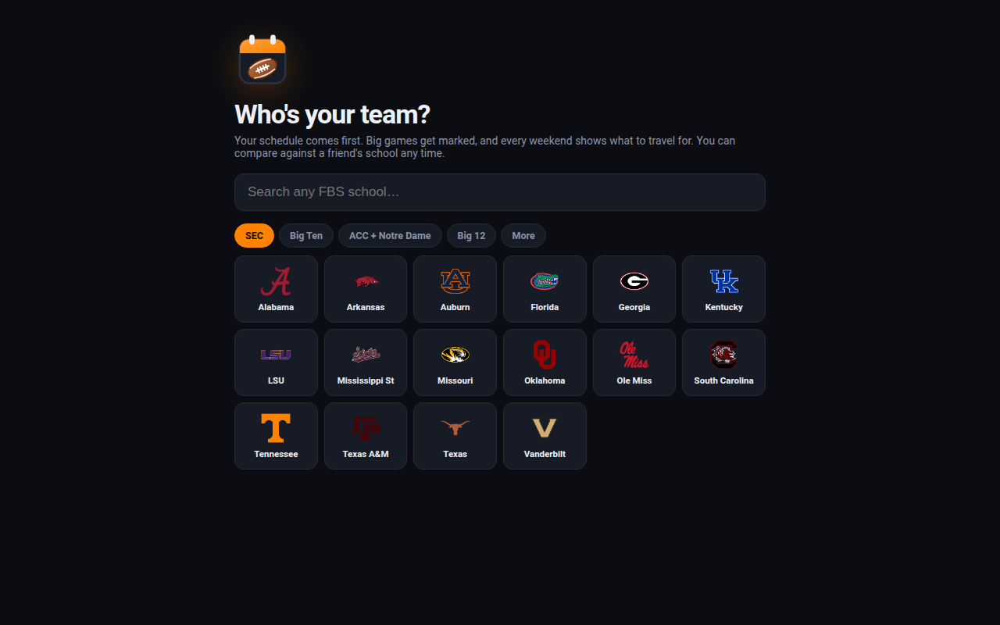

# Gameday Planner

Plan a college football season with friends. Pick your team, compare its schedule with a friend's school, mark the games you're going to, and see which weekends are worth the trip.

**Live:** [sec.looperdeluxe.com](https://sec.looperdeluxe.com)



## What it does

- Every FBS team's 2026 regular season, with scores, rankings and kickoff times
- Side-by-side schedules for your school and a friend's
- "Going" marks and a crew list, so everyone can see who's at which game
- Top travel weekends, kickoff weather, ticket links and add-to-calendar
- Installs on a phone like an app

## How it works

| Piece | What it does |
| --- | --- |
| `build_gameday_data.py` | Pulls teams, schedules, scores and rankings from ESPN's public site API, geocodes stadium cities with OpenStreetMap's Nominatim (cached in `geocode_cache.json`), and writes one small `data/games.json`. |
| Scheduled refresh | A scheduled job reruns the builder five times a day and publishes the result here. That's what the `data: refresh` commits are. `ci/refresh-data.yml` is the same job as a GitHub Actions workflow, for anyone who'd rather run it on GitHub. |
| `index.html` | The whole app: one static page, no build step, no framework. |

## Decisions

- **No backend, on purpose.** There's nothing to host and nothing to leak. Crew names and "going" marks live in each visitor's own browser (localStorage) and are never sent anywhere. No accounts and no analytics.
- **No API keys.** Weather comes from the National Weather Service (api.weather.gov), which is free and keyless. Ticket and calendar links just open SeatGeek and Google Calendar.
- **Left out on purpose:** carpools and "who's going" alerts. Not everyone wants to be tracked to a game.

## How I built it

I came up with the idea for planning game trips with my fraternity and decided what it should and shouldn't do (no backend, no accounts, no carpool tracking). The code was written with Claude Code, an AI coding assistant, working from my direction.

## Run it yourself

1. Fork this repo, then Settings → Pages → Deploy from branch → `main` / root.
2. Rebuild the data whenever you like:
   ```
   GD_OUT=data/games.json GD_GEO=geocode_cache.json python3 build_gameday_data.py
   ```
   Needs Python 3 and `curl`. ESPN's site API is public but unofficial, so it can change without notice.
3. To refresh on GitHub instead of a server, move `ci/refresh-data.yml` into `.github/workflows/` and give Actions read and write permission.
